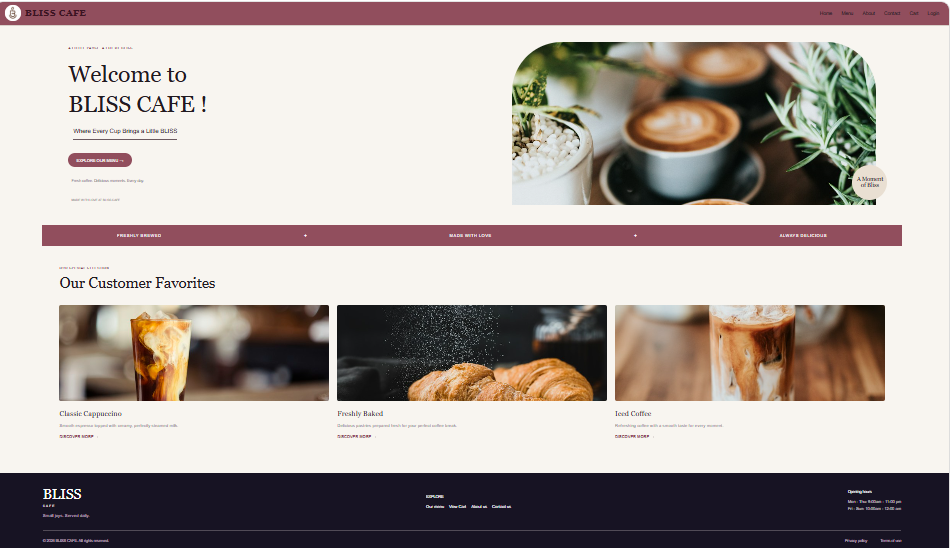
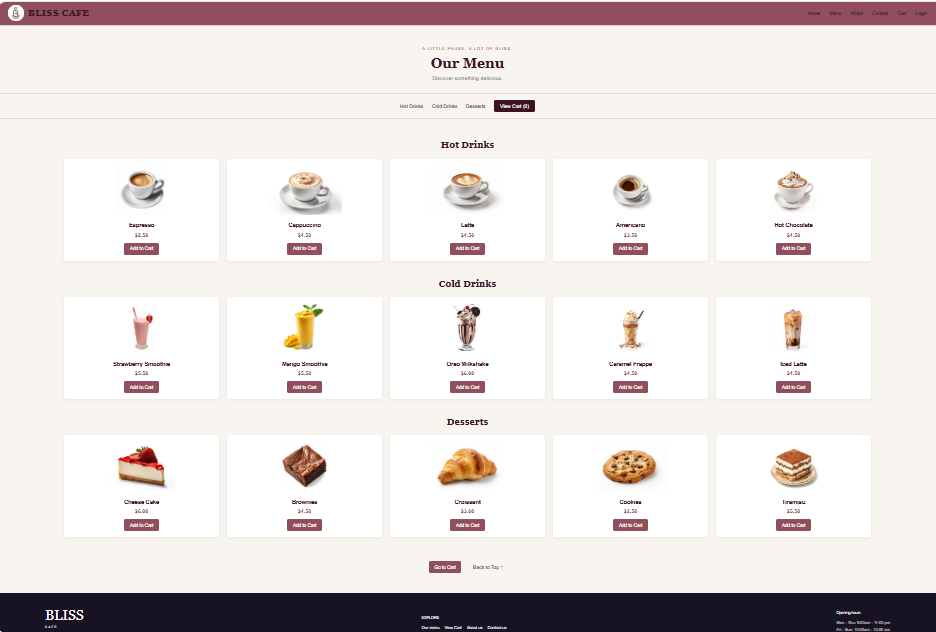
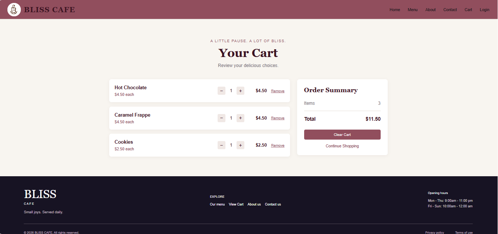
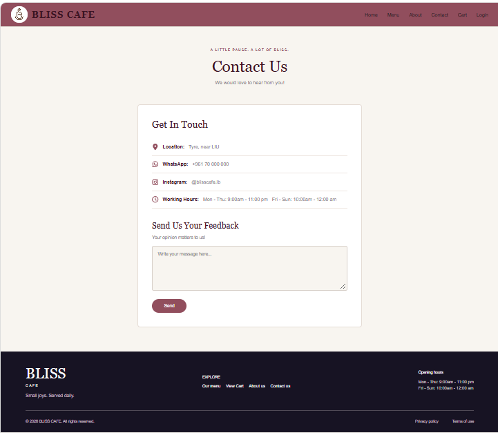

# Cafe Website

## Project Description

Bliss Cafe – Online Ordering Website

Bliss Cafe is a responsive website developed using React.js that allows customers to explore the cafe's menu, view products, and add items to a shopping cart. It also includes login, about, and contact pages to provide users with a simple and convenient browsing experience.

### Main Features

- Home page introducing the cafe.
- Menu page displaying available products.
- Shopping cart functionality.
- Login page.
- About page.
- Contact page with a feedback form.
- Responsive navigation bar and footer.

## Technologies Used

- React.js
- JavaScript
- HTML / JSX
- CSS
- React Router
- React Context API
- React Icons

## Installation and Setup

1. Clone the repository:

   ```bash
   git clone YOUR_GITHUB_REPOSITORY_LINK
   ```

2. Navigate to the project folder:

   ```bash
   cd cafe
   ```

3. Install dependencies:

   ```bash
   npm install
   ```

4. Start the development server:

   ```bash
   npm start
   ```

   If your project uses Vite, use `npm run dev` instead.

### Home Page



### Menu Page



### Shopping Cart



### Login Page

./screenshots/login.png

### Contact Page



## Author

Zainab
